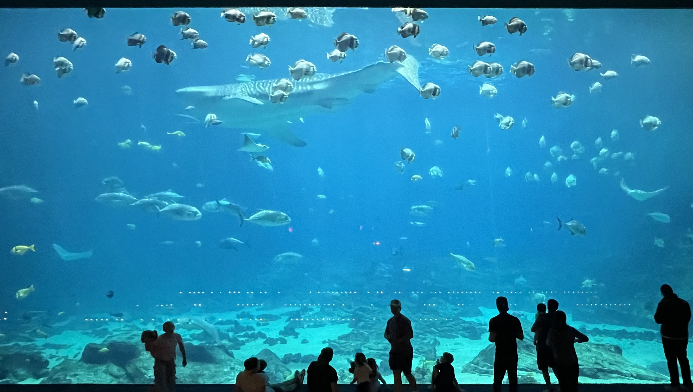
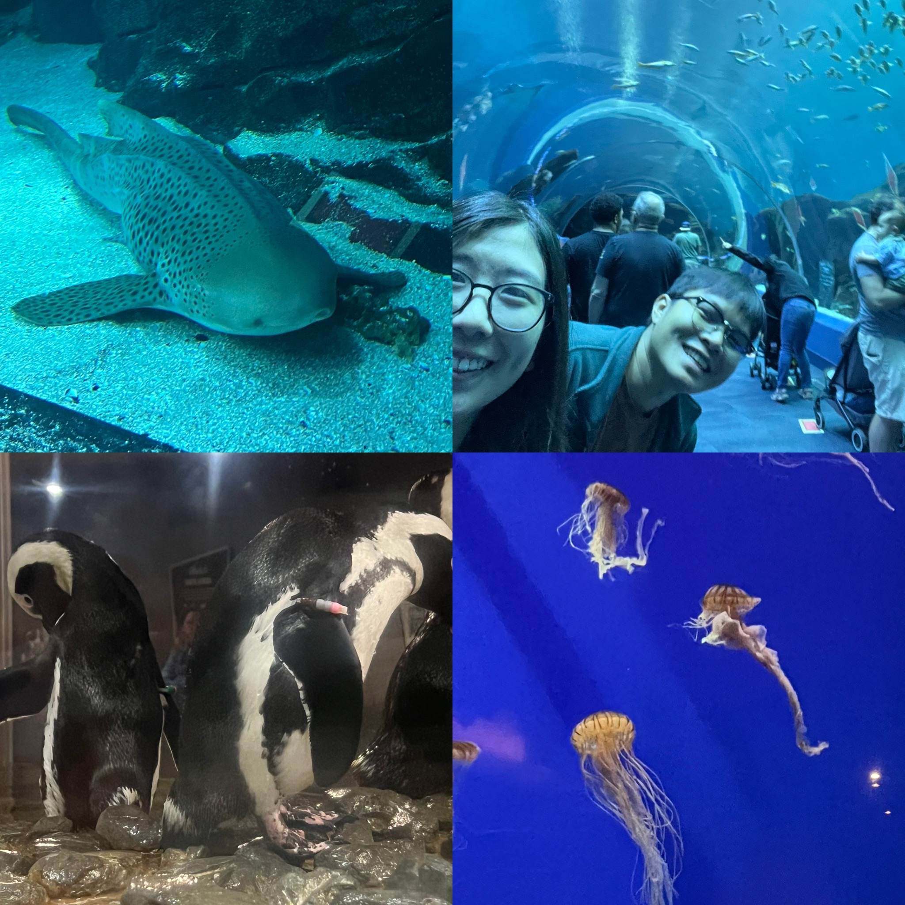
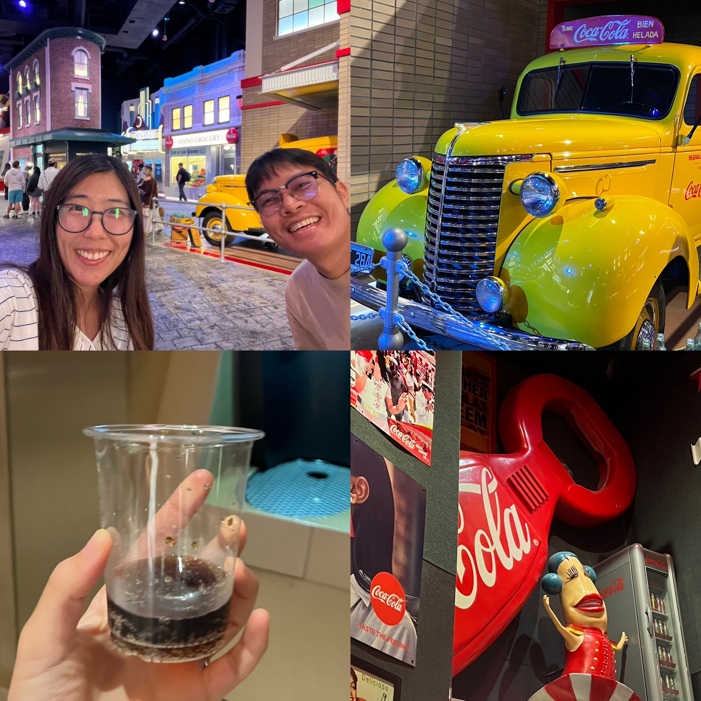
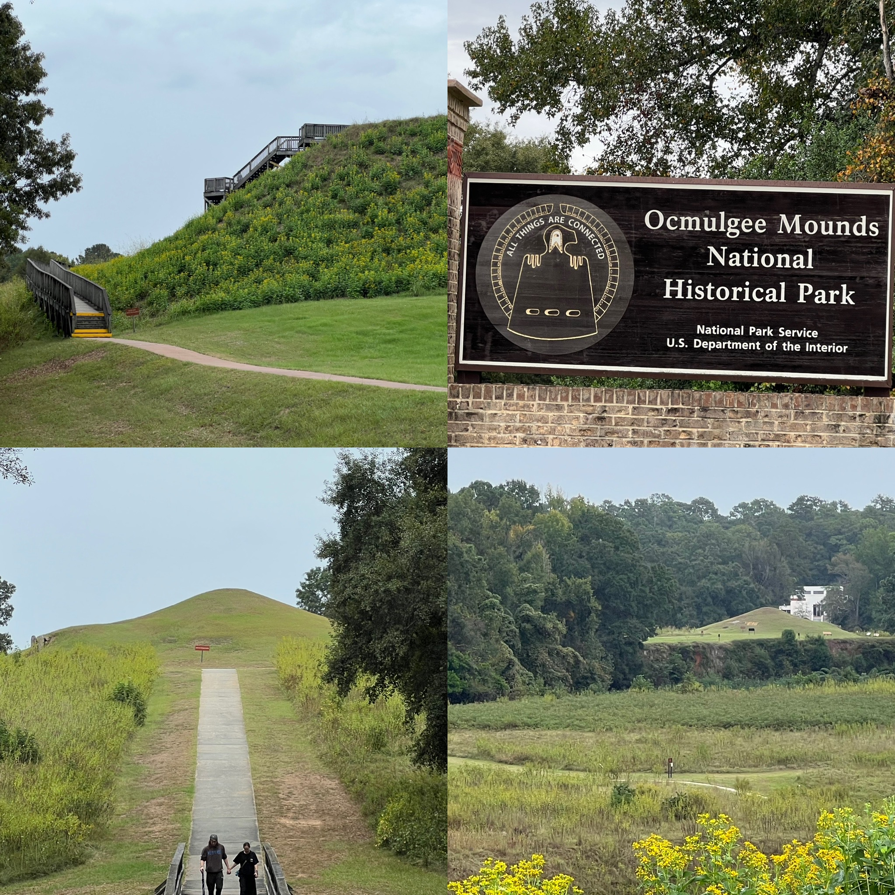
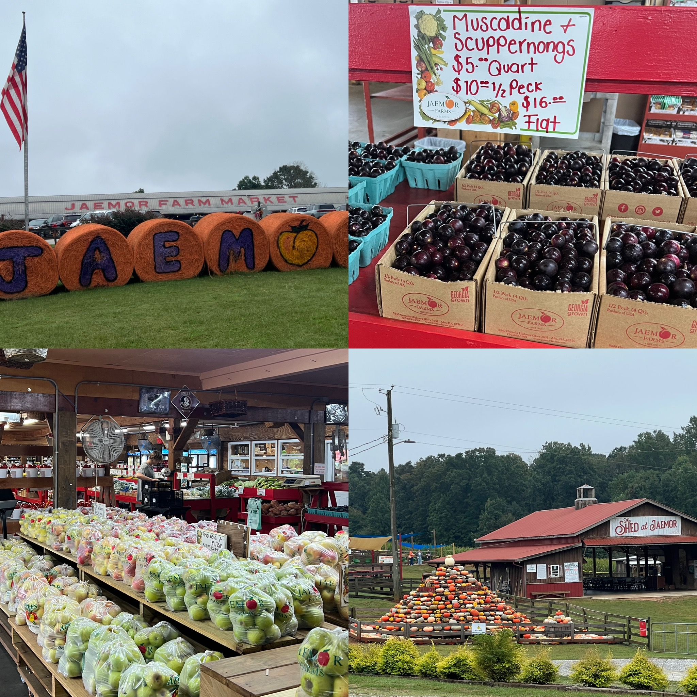
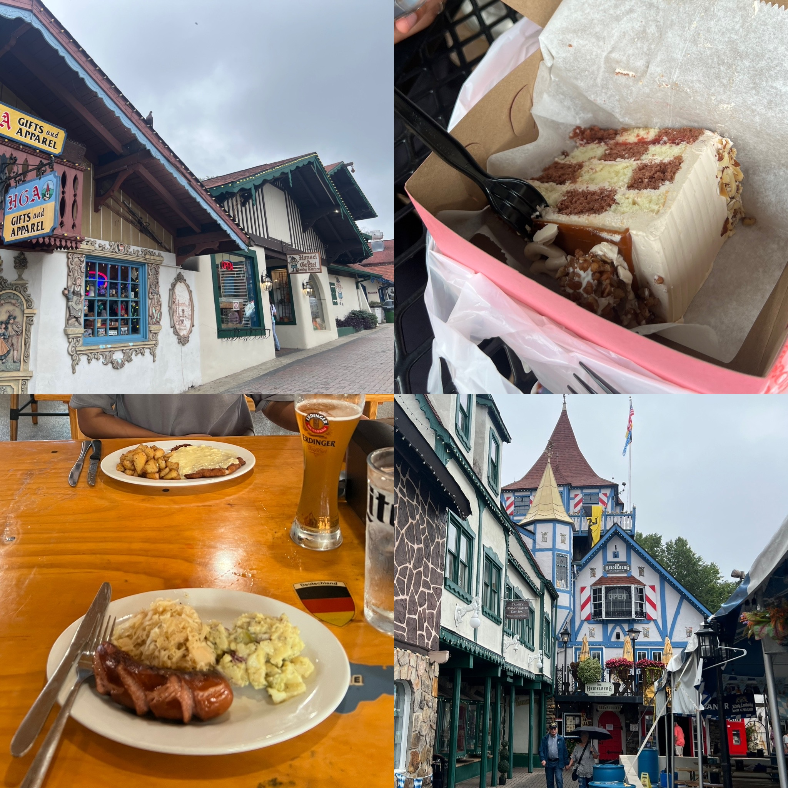
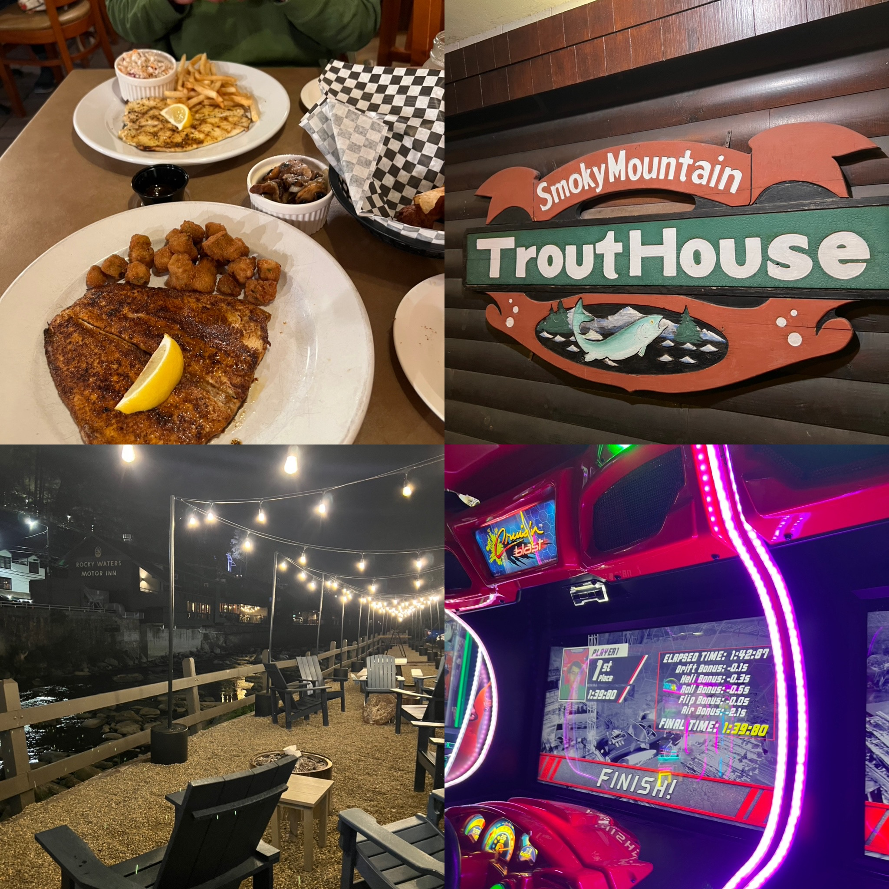
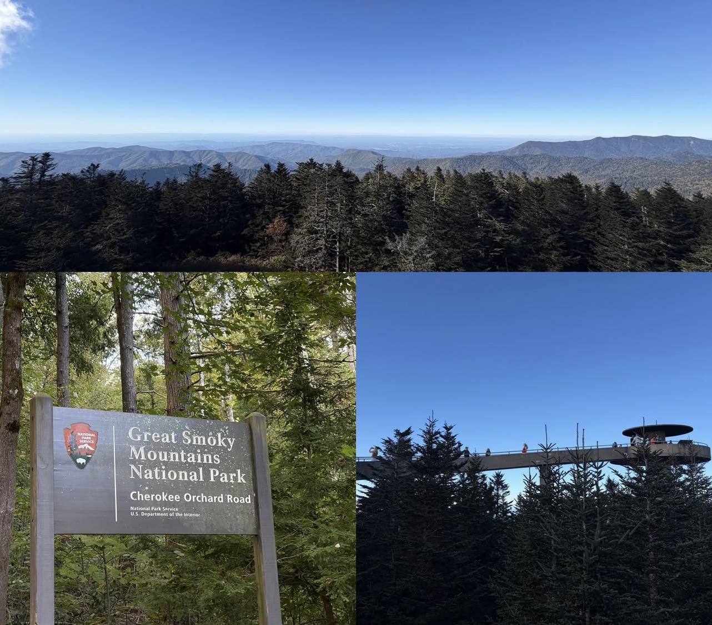

After the PANTS XLI conference, which was held in Atlanta, we had a chance to explore some of the city's attractions, including the Georgia Aquarium and the World of Coca-Cola. Since we were already in the area, we decided to venture a little farther and visit Ocmulgee Mounds National Historical Park, which may one day become a new U.S. national park. On our way back to Virginia, we also stopped at several places worth visiting, including Helen, GA, a Bavarian-style town, Gatlinburg, TN, and, of course, the Great Smoky Mountains National Park. And to our surprise, after visiting 51 national parks, this was the first time we had ever spotted bear cubs!

  

**Georgia Aquarium**

The Georgia Aquarium is the largest aquarium in the Western Hemisphere, housing tens of thousands of marine animals in more than 11 million gallons of water. Of course, the admission price is a little higher than that of other aquariums we have visited in the US, but if you plan ahead and make reservations for the shows included with your admission, it is well worth the money.
The highlight of the aquarium is undoubtedly its enormous Ocean Voyager exhibit, a 6.3-million-gallon tank housing a whale shark, among many other marine creatures. It reminded us of the giant aquarium tank in Okinawa, Japan. Interestingly, the Georgia Aquarium is the only aquarium in the United States that houses whale sharks.

  

There used to be two whale sharks here, but sadly, one of them, Taroko, passed away in August 2025, leaving just one for us to see during our visit. The aquarium's whale sharks were originally rescued from Taiwan's commercial fishing industry, where they would otherwise have been sold for food. It is remarkable to see these gentle giants up close, and I appreciate the aquarium's efforts in caring for and studying them.

Since we visited in October, the aquarium was already in full Halloween spirit, with decorations throughout the exhibits and even divers wearing skeleton-themed swimming suits!
The two shows included with general admission are the sea lion and dolphin presentations. The sea lions were incredibly cute and energetic, while the dolphin show was very, very fun and splashy (or rather, soaky!). Be warned: if you choose some of the best seats in the house, you are almost guaranteed to leave soaking wet!

  

**World of Coca-Cola**

Our next stop was the World of Coca-Cola, conveniently located right next door. You can simply leave your car in the aquarium's parking garage and visit both attractions without having to move it.

The museum features several permanent exhibitions showcasing Coca-Cola's history, vintage advertisements, memorabilia, and collectibles. There are also two particularly fun tasting areas: the Beverage Lab, where you can experiment with different flavor combinations and learn about beverage development, and Taste It!, where you can sample Coca-Cola products from around the world, including some beverages that have since been discontinued.

It was a fun experience filled with both delicious and, well, quite the opposite of delicious discoveries. I do think the admission price is a little high for what you get out of the visit, though.

  

**Ocmulgee Mounds National Historical Park**

Before calling it a day, we drove to Ocmulgee Mounds National Historical Park in Macon, Georgia.
Formerly known as Ocmulgee National Monument, this park preserves an important archaeological site documenting more than 12,000 years of Indigenous history. Its most prominent features are the massive earthen mounds constructed by the Mississippian people beginning around 900 CE, whose descendants include the present-day Muscogee (Creek) Nation. The largest of these, the Great Temple Mound, stands approximately 55 feet tall.

There is currently an effort to redesignate the site as a national park and preserve, so perhaps we will have another national park to add to our list in the future!

It was drizzling and foggy for most of our visit, but the weather actually made the grassy mounds look especially vibrant and green. We also spotted several deer peacefully grazing around the mounds, which added to the serene atmosphere.

Admission to the park is completely free. This is one of the many reasons we love exploring national parks, national monuments, and other sites managed by the National Park Service. You can discover so many fascinating places, often without spending a single dollar on admission.

  

**Jaemor Farm Market**

The next morning (October 5), we began making our way back toward Virginia, with plans to spend another night in Gatlinburg.
We stopped for breakfast at Jaemor Farm Market, a huge farm market offering local produce, seasonal desserts, and all sorts of homemade goodies. One interesting discovery was muscadines, a species of grape native to the southeastern United States, known for its thick skin and distinctive flavor. We had never tried them before, but unfortunately, they were sold in quantities a little too large for us to finish on a road trip. We also learned that boiled peanuts are apparently a big thing in Georgia and throughout the South. We are still not entirely sure what makes them so special, though!

  

**A Little Taste of Germany in Helen, Georgia**

Our next stop was very much TikTok-inspired, haha.

Helen, GA, is a small mountain town in northern Georgia that was transformed into a Bavarian-style village in the late 1960s. With its Alpine-inspired architecture, German restaurants, bakeries, and beer gardens, it offers a little taste of Germany without having to cross the Atlantic.

Since we were already passing through the area, we figured we might as well stop for lunch. We chose to dine in the beer garden at Bodensee Restaurant, where we ordered some classic German dishes, including pork schnitzel and German sausages.
The food was incredibly flavorful—perhaps even more flavorful than some of the food I had during my actual visit to Germany! I am not entirely sure whether the recipes have been adapted to suit American palates, but either way, we really enjoyed our meal. The prices were also quite reasonable, and they had great beer.

Before heading to Gatlinburg, we also picked up a German-style cake from Hofer's Bakery and Café.
To be fair, I would not say that the town itself is quite as charming as the real Bavarian towns in Germany, but I do think it makes a great stop if you are craving some good German food!

  

**An Evening in Gatlinburg, Tennessee**

We arrived in Gatlinburg in the evening. After checking into our accommodation, we decided to have dinner at the Smoky Mountain Trout House, a small, long-established restaurant specializing in trout dishes.
We ordered trout prepared in two different ways: blackened and simply grilled. Both were fresh, delicious, and served surprisingly quickly.
After dinner, we strolled along the main street of Gatlinburg and stumbled upon an old-school arcade. We spent around $10 and somehow managed to keep ourselves entertained for more than half an hour. Perhaps they stopped raising the prices as the arcade machines grew older, haha. It was a simple but surprisingly enjoyable way to end the evening.

  

**Great Smoky Mountains National Park: Finally, Bear Cubs!**

On the last day of our trip (October 6), we set out very early in the morning for a scenic drive along the Roaring Fork Motor Nature Trail, hoping to spot some American black bears.

And to our absolute surprise, we—two people who usually have remarkably little luck when it comes to wildlife spotting—finally saw bear cubs! They were climbing trees just 15 meters or so from us. Everything happened so quickly that our camera managed to capture little more than blurry black shadows jumping around. But honestly, after visiting 51 national parks, finally getting to see bear cubs in the wild was such a special moment for us. Our hearts were so full, even if our photos were not particularly impressive!

Before heading home, we spent a little more time revisiting the Great Smoky Mountains National Park. This time, we finally made it up to the Kuwohi Observation Tower, formerly known as the Clingmans Dome Observation Tower. Sitting atop the highest peak in the park at 6,643 feet (2,025 meters), the tower offers panoramic views of the surrounding mountains. Although the paved trail leading up to the tower is relatively short, it is surprisingly steep!

With what little energy we had left in our bodies, but with our hearts full of joy and wonderful new memories, we made our way safely back home.

