Our adventure began on Friday, November 20, when we picked up our rental car in the morning and drove six hours southwest to America's newest national park, Chiricahua National Park in Arizona. Along the way, we stocked up on some snacks for the road trip. New Mexico is not among the wealthiest states in the US, and even in Albuquerque, you won't see much of a towering skyline. However, what the state may lack in skyscrapers, it more than makes up for in its rich history, distinctive culture, and friendly people.

  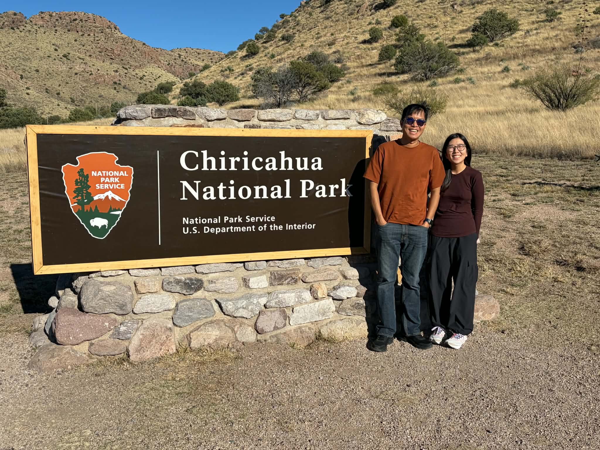

**November 20: Chiricahua National Park**

Chiricahua was officially redesignated as America's 64th national park in October 2026, just a month before our visit! Naturally, we started by snapping a picture with the newly updated welcome sign. We then stopped by the visitor center to take advantage of the 30% discount on magnets that still carried the "National Monument" label. A little piece of history at a discounted price!

Often referred to as a "Wonderland of Rocks," Chiricahua is famous for its towering rock pinnacles, hoodoos, and precariously balanced rocks. These formations originated from a massive volcanic eruption approximately 27 million years ago and were gradually sculpted by erosion. We initially drove to the Echo Canyon and Sugarloaf Mountain trailheads. Both have limited parking, and some of the hikes leading to the more iconic rock formations can be quite lengthy. After exploring our options, we decided to drive farther up to Massai Point and hike from there.

  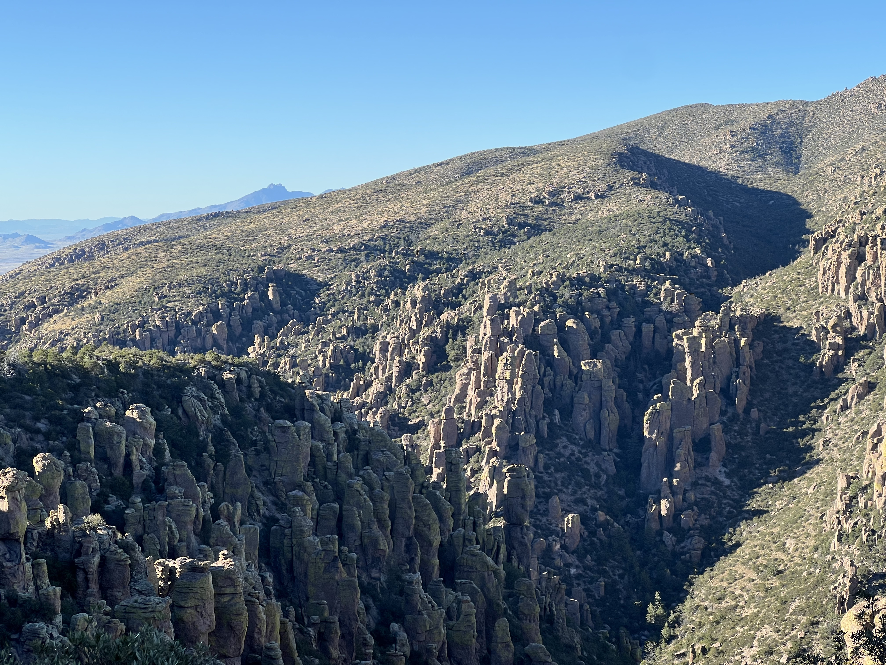

The short trail offered spectacular views of countless hoodoos beneath a beautifully clear blue sky, although the setting sun made it a little difficult to fully appreciate some of the views. I think visiting this part of the park in the morning would be ideal. Overall, though, it was a really cool experience. We were also pleasantly surprised by how lush and green the park was, despite its proximity to the desert.

In the evening, we drove to Silver City, New Mexico, to rest for the night. We stayed at the locally owned LuLu Hotel, where we were welcomed by very friendly staff.

**November 21: From Ancient Dwellings to Distant Galaxies**

Our goal for the day was to make our way north to Santa Fe, which is about a five-hour drive from Silver City. Since we were already in the area, however, we decided to explore a few interesting places suggested by Google Maps. Naturally, our five-hour drive turned into an almost full-day adventure.

  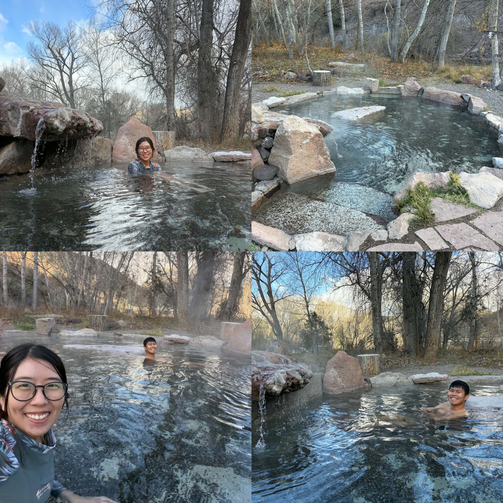

**Gila Hot Springs**

Our first stop was Gila Hot Springs, a small community located just before Gila Cliff Dwellings National Monument.

We visited the Gila Hot Springs Campground, which features three natural hot spring pools along the Gila River. The admission fee was only $8 per person, the restrooms were clean, and the surroundings were peaceful. There was something particularly satisfying about soaking in warm natural hot springs on a cold November morning. We spent about half an hour soaking before moving on to our next destination.

  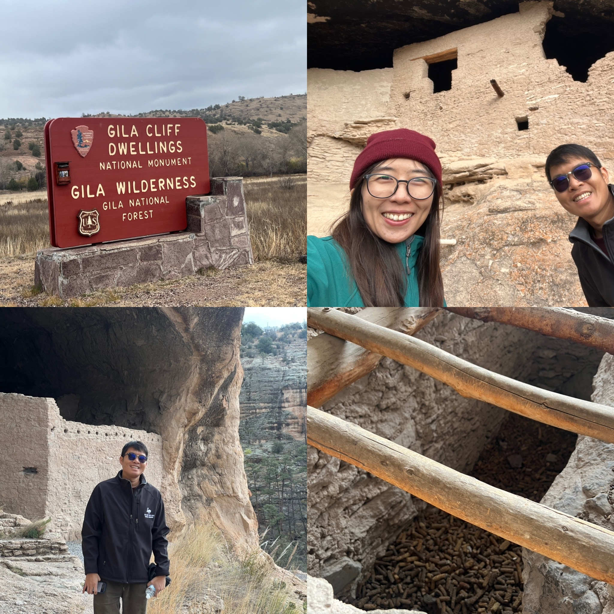

**Gila Cliff Dwellings National Monument**

Gila Cliff Dwellings National Monument preserves a fascinating archaeological site tucked away in the mountains of the Gila Wilderness.

Unlike many of the more familiar cliff dwellings across the American Southwest, which are associated with the Ancestral Puebloan archaeological tradition, these dwellings were constructed by people of the Mogollon culture, specifically the Tularosa Mogollon. Their descendants are believed to be among today's Pueblo peoples.

What makes this site particularly interesting is the remarkably short period during which the dwellings were occupied. Most of the structures were built in the late 1200s, and archaeologists believe the inhabitants lived here for only about 20–30 years before moving elsewhere around 1300 CE. The exact reason for their departure remains unknown.

Before embarking on our little adventure, we found some very nice jackets at the park store for 75% off. Apparently, souvenir shopping was going particularly well on this trip! 

We followed the main Cliff Dwellings Trail, a beautiful one-mile loop that winds through a surprisingly lush green canyon, following a small creek before gradually climbing toward the caves. Once we reached the dwellings, a park staff member gave us a short but very informative tour. We learned about the daily lives of the people who once inhabited these caves and spotted some easily overlooked pictographs, as well as remnants of corn cobs left behind more than 700 years ago.

It was fascinating to imagine people living in these caves centuries ago and to see how much of their everyday lives had been preserved. The entire loop took us only about an hour. We returned around noon and had lunch in our car, as usual.

  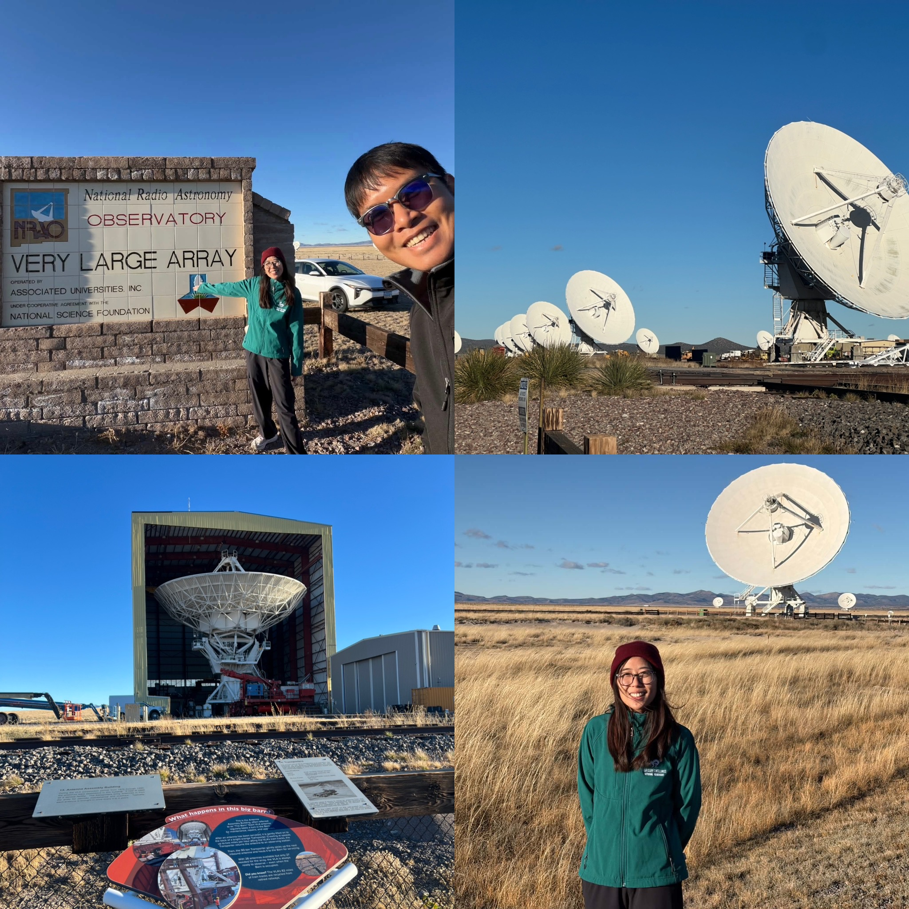

**The Very Large Array (VLA)**

Originally, we had hoped to see the collection of Mimbres pottery at the Western New Mexico University Museum in Silver City, but unfortunately, it was closed for Thanksgiving break. How sad! Instead, we headed to the Very Large Array, or VLA, located on the vast Plains of San Agustin in central New Mexico.

The VLA is one of the world's most renowned radio astronomy observatories. It consists of 27 operational radio antennas, each measuring 25 meters in diameter, arranged in a giant Y-shaped configuration. By combining the signals received by these individual antennas, astronomers can effectively create a virtual telescope with much greater resolving power than any of the individual dishes. The facility allows scientists to study phenomena such as distant galaxies, black holes, and star formation.

The visitor center was almost closing when we arrived, so the staff kindly let us visit for free. We didn't have much time to explore, but given the freezing temperatures and strong winds, we probably wouldn't have wanted to stay much longer anyway! The self-guided walking trail was quite informative, and we also got to see the enormous antenna maintenance facility. The VLA actually has 28 antennas in total, with one serving as a spare so that antennas can undergo routine maintenance while the other 27 continue operating.

  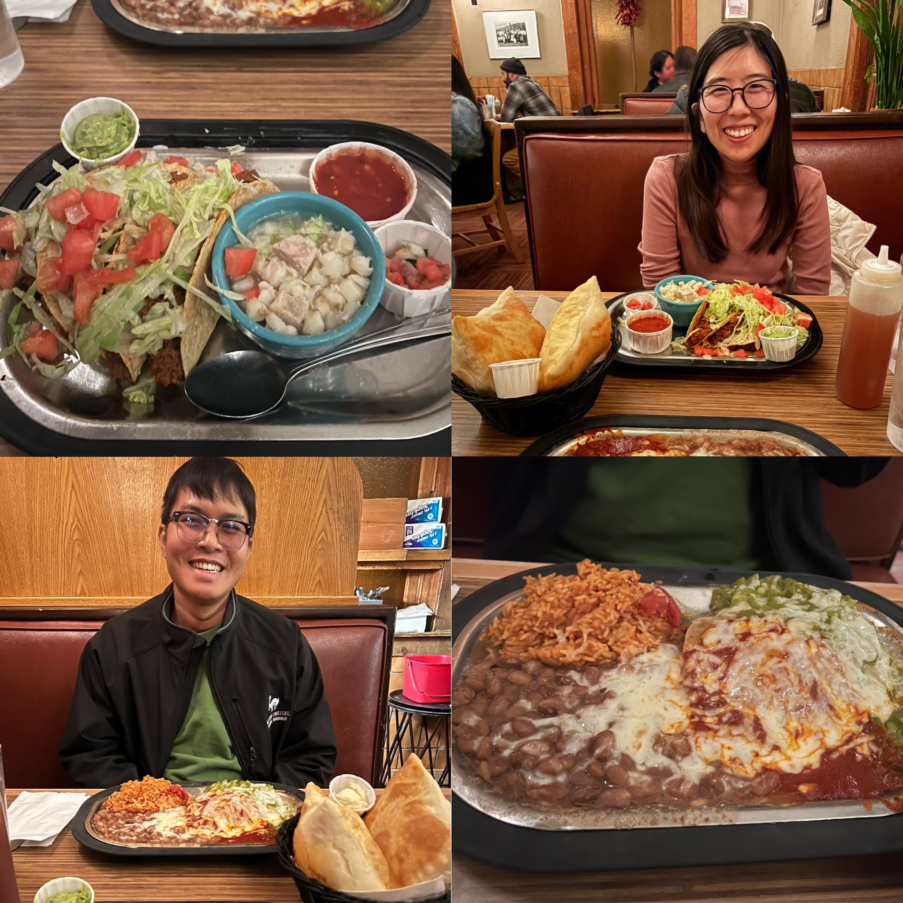

**An Evening in Santa Fe**

We finally arrived in Santa Fe in the evening and checked into El Sendero Inn, a nice, budget-friendly hotel conveniently located in downtown Santa Fe.

Before calling it a night, we treated ourselves to a warm and spicy dinner at Tomasita's, a popular restaurant serving traditional New Mexican cuisine. We ordered enchiladas with "Christmas-style" chile, beef tacos, and, of course, a frozen margarita! For those unfamiliar with New Mexican cuisine, ordering something Christmas-style means having both red and green chile sauces on the same dish.

The meal was absolutely delicious, and we loved the lively and welcoming atmosphere of the restaurant. It was a perfect way to end a long day on the road.

  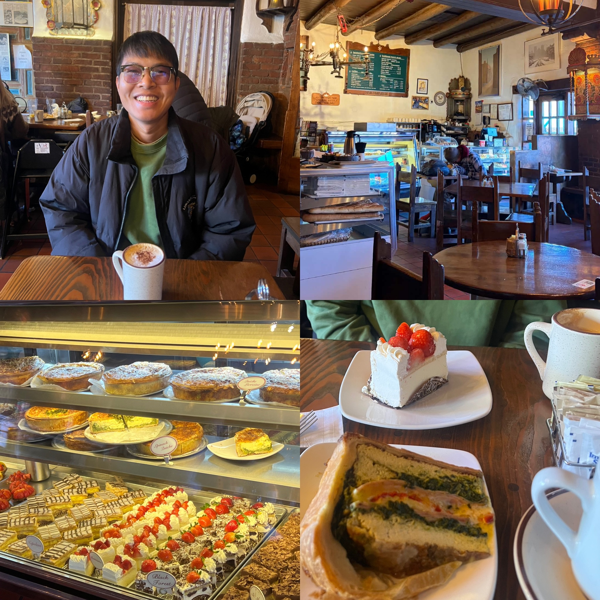

**November 22: A Morning in Downtown Santa Fe**

We started our morning in downtown Santa Fe at the French Pastry Shop, located inside the historic La Fonda Hotel. It was one of the few places that opened as early as 6:30 AM.

We ordered a Tourte Milanese and a Montmartre cake for breakfast. It was a cozy and filling meal, although perhaps a little too rich for my palate first thing in the morning. After breakfast, we wandered around downtown, doing some window shopping and exploring the city's historic churches and chapels.

  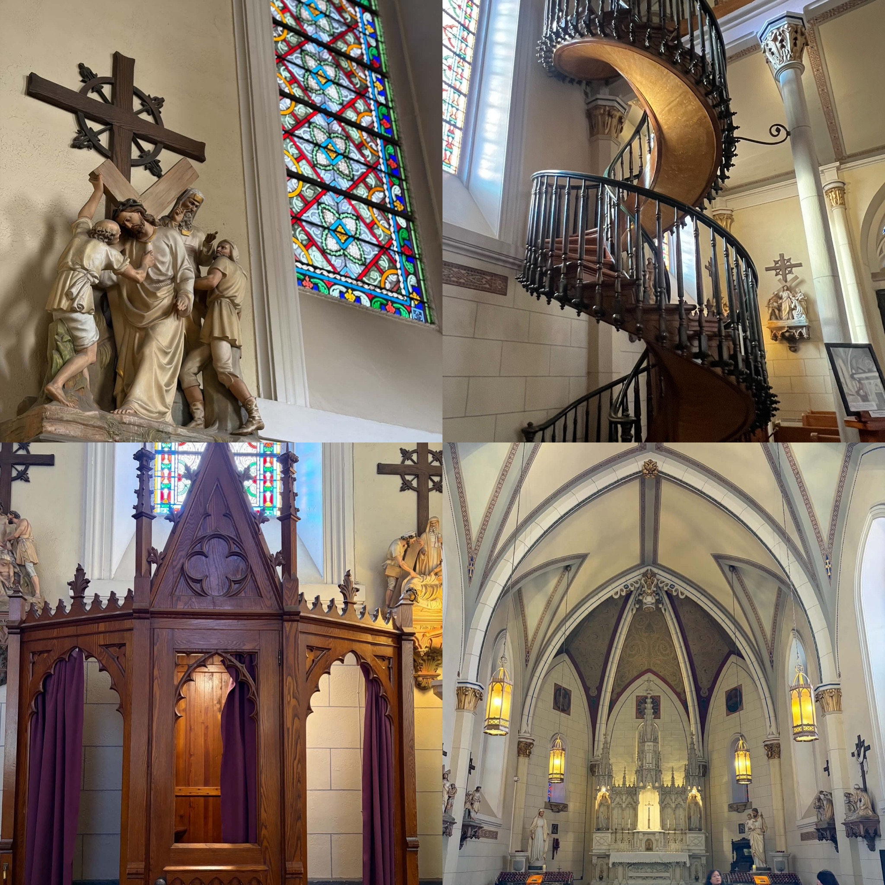

There are three particularly well-known religious landmarks in downtown Santa Fe: the Cathedral Basilica of St. Francis of Assisi, San Miguel Chapel, and Loretto Chapel.

We only visited the interior of Loretto Chapel, which charged an admission fee of $5 per person (not particularly cheap for such a small chapel). Its main attraction is the famous Miraculous Staircase, a wooden spiral staircase that makes two complete turns without a conventional central supporting column. The staircase is also surrounded by legends concerning the mysterious carpenter who built it.

  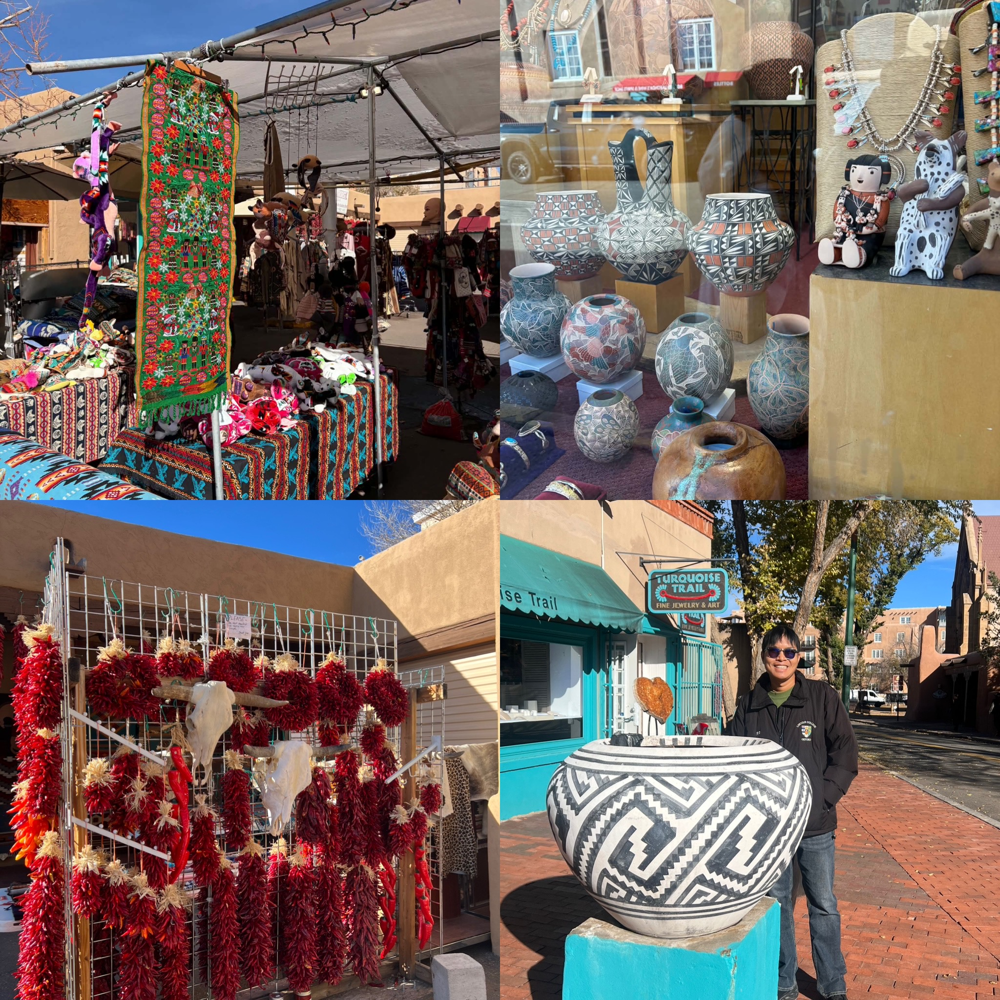

The other two churches didn't open until later in the day, so we spent the rest of our morning wandering around the streets, admiring the beautiful pottery, adobe architecture, and countless strings of dried red chiles hanging outside the shops. These decorative strings of chiles, known as ristras, are such a distinctive feature of New Mexico. Santa Fe really does have a character of its own, quite unlike most other American cities we have visited.

  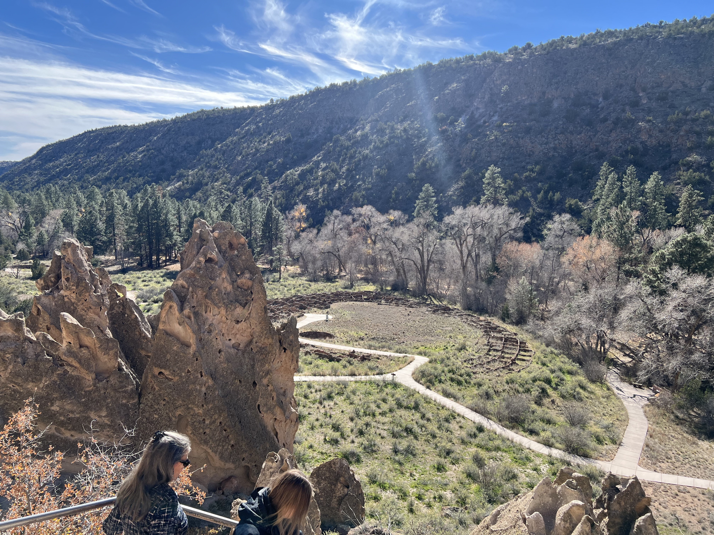

**Bandelier National Monument**

We then drove about an hour northwest of Santa Fe to Bandelier National Monument. Since our annual national park pass had recently expired, we paid the $25 entrance fee per vehicle. Bandelier preserves the remains of settlements inhabited by Ancestral Pueblo people, particularly between the 12th and 16th centuries. The inhabitants carved rooms into the relatively soft volcanic rock of Frijoles Canyon and constructed additional dwellings along the base of the cliffs.

We took a relatively short hike along the Pueblo Loop Trail toward the Long House before making our way back. One of the highlights was Tyuonyi, a large, roughly circular pueblo built around a central plaza on the canyon floor. The foundations of its numerous rooms are still remarkably well preserved, making it easy to imagine what the village might have looked like centuries ago.

As we made our way toward the cliff dwellings, we also had the opportunity to climb some wooden ladders and peek inside the small cave-like rooms carved into the rock. The surrounding landscape was equally beautiful. Other destinations worth exploring in northern New Mexico include Taos and Ghost Ranch, but unfortunately, we didn't have enough time to squeeze everything into this trip. Perhaps next time!

  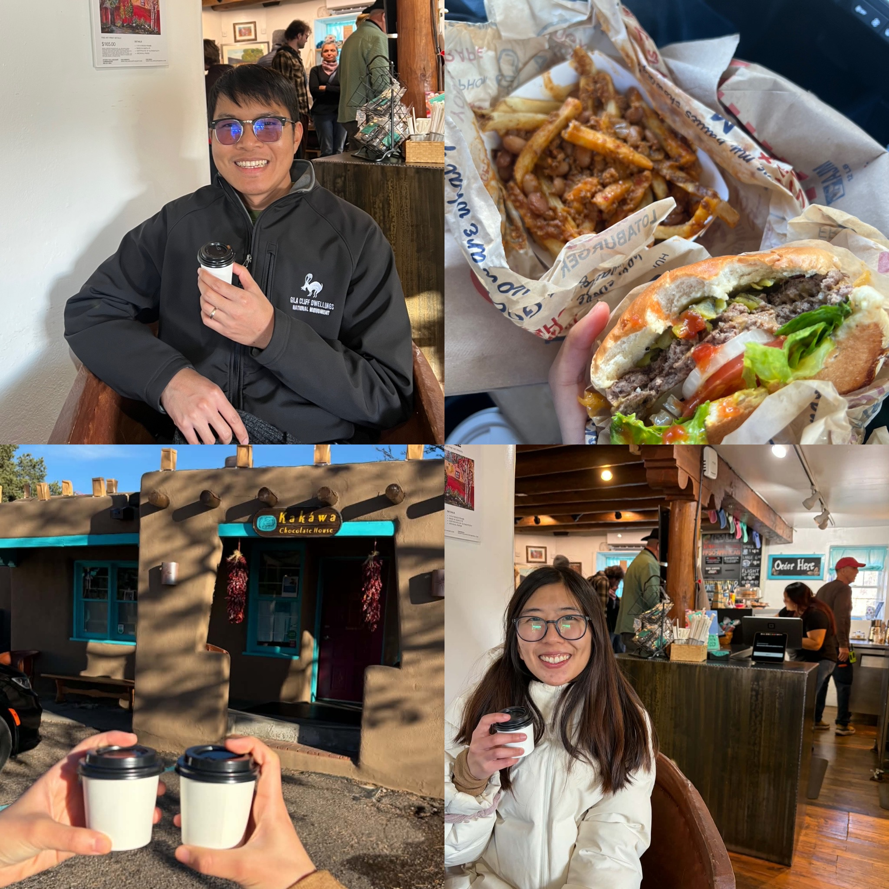

**Green Chiles, Mimbres Pottery, and Hot Chocolate**

We returned to Santa Fe for lunch at Blake's Lotaburger, a popular fast-food chain that originated in New Mexico. We ordered their signature Hatch green chile burger and chile fries. The portions were huge, and the entire meal cost us only about $14. It was certainly a great value, and we couldn't possibly leave New Mexico without trying a proper green chile cheeseburger!

After lunch, we moved on from window shopping to some actual shopping. Remember how we missed the opportunity to see the original Mimbres pottery in Silver City? Well, we came across the Chile Shop, which sells Mimbreño dinnerware featuring designs inspired by traditional Mimbres pottery. The Mimbres people are particularly well known for their black-on-white ceramic bowls, decorated with geometric patterns and remarkably creative depictions of animals, humans, and other elements of their world. We each bought a small butter chip featuring an adorable animal design inspired by the imagination of the Mimbres artists. At least we managed to bring a little piece of that artistic tradition home with us! 

Before leaving downtown Santa Fe, we drove along Canyon Road, which is famous for its numerous art galleries, before stopping by Kakawa Chocolate House. The staff generously offered us several samples of their drinking chocolates, and we eventually settled on the chile hot chocolate (100% cacao) and Kakawa's American hot chocolate (74% cacao). Both were incredibly rich, flavorful, and delicious. There is something very satisfying about drinking real, intensely flavored hot chocolate on a cold day.

  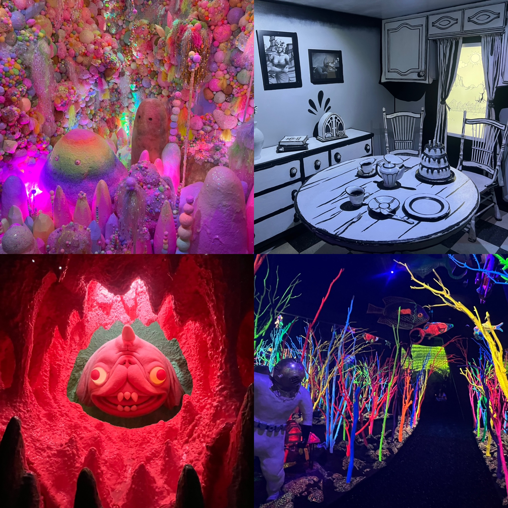

**Meow Wolf: House of Eternal Return**

Our final stop before heading back to Albuquerque was Meow Wolf's House of Eternal Return in Santa Fe. This is Meow Wolf's original permanent immersive art exhibition, featuring a seemingly ordinary house that opens into a series of surreal, interconnected worlds. The exhibition combines art installations, interactive elements, hidden passageways, and a mysterious underlying storyline.

The admission prices were quite steep, as we happened to visit during one of the more popular time slots. We did regret not doing enough research beforehand to take advantage of their dynamic pricing.

  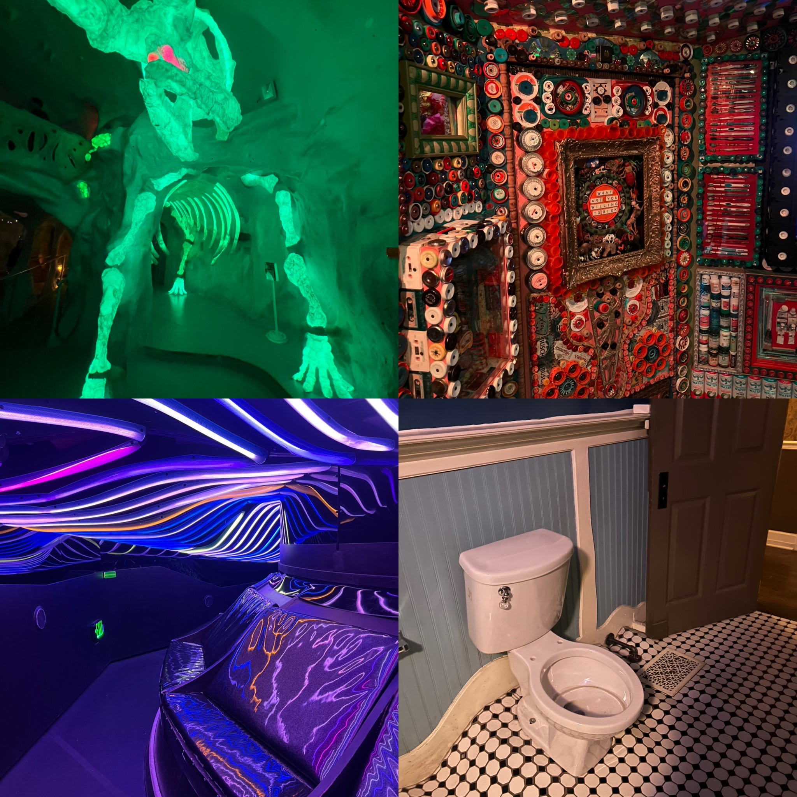

Nevertheless, the exhibition itself was excellent. What I particularly appreciated was that it wasn't simply a collection of rooms designed for Instagram-worthy photos. Instead, you could genuinely appreciate the creativity of the artists, the beautifully designed spaces, the attention to detail, and some wonderfully bizarre stories.

It was such an imaginative experience and a fitting way to conclude our trip. We spent our final night at the Monterey Motel near Old Town Albuquerque. The room cost us only $75, and somehow, that price even included two complimentary cocktails! I still don't know how they managed to offer such a deal, but we certainly appreciated their hospitality.

The following morning, we caught our flight back to Chicago. Our trip may have been short, but we certainly managed to milk every minute of it! From the country's newest national park and centuries-old cliff dwellings to giant radio telescopes, green chile cheeseburgers, and wonderfully bizarre art installations, the American Southwest gave us a little bit of everything in just three days.

